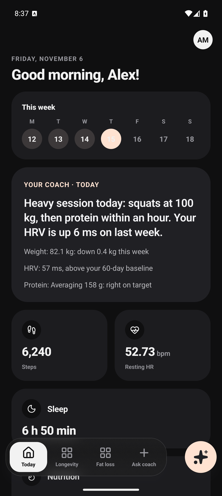
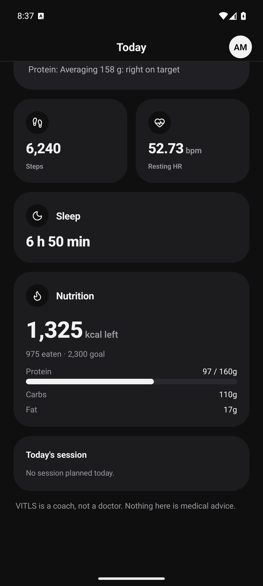

# VITLS

The AI coach that runs your whole body — reads your vitals, protects your progress, remembers your story, holds you accountable.
Domain: vitls.ai.

## Layout

| Path | What |
|---|---|
| `apps/app` | The VITLS mobile app (Expo / React Native, NativeWind): native dashboards, coach chat, Apple Health / Health Connect sync |
| `apps/server` | NestJS backend: auth (BetterAuth magic link), device pairing, health ingest, coach (Anthropic) |
| `apps/web` | Marketing site for vitls.ai — Next.js, next-intl (en, sk, cs, es, it, ru), GSAP, liquid glass; agent instructions at `/llms.txt` |
| `apps/gccli-sync` | Development-only Garmin source that pushes data through the same pairing + ingest contract as the app |
| `packages/*` | Shared packages (`dashboard`, `health-ingest`, `physiology`, `typescript-config`) |
| `infra` | Local Postgres + TimescaleDB and Mailpit (`pnpm infra:up`) |
| `docs` | Research, design and decision log |

## Screenshots

Fictional demo data.

<p>
  
  
</p>

## Quick start

You need Node 22 (`.nvmrc`), pnpm 12 and Docker.

```bash
git clone --recurse-submodules https://github.com/amirmamaghani/VITLS.git
cd VITLS
pnpm install

# 1. Infra: Postgres + TimescaleDB on :5435, Mailpit (catches sign-in e-mails) on http://localhost:8027
pnpm infra:up

# 2. Server on :3001
cp apps/server/.env.local.example apps/server/.env.local   # fill DATABASE_URL, BETTER_AUTH_SECRET, VITLS_FIELD_KEYS, ANTHROPIC_API_KEY
pnpm --filter @vitls/server db:migrate
pnpm --filter @vitls/server start

# 3. Mobile app (needs a development build: HealthKit / Health Connect are native)
cd apps/app
EXPO_PUBLIC_VITLS_SERVER=http://<your-lan-ip>:3001 npx expo run:android   # or run:ios
```

Sign in with the magic link from Mailpit. Marketing site: `pnpm web` (http://localhost:3000). Other commands: `pnpm typecheck`, `pnpm test`.

## License

[AGPL-3.0](LICENSE). If you run a modified version as a network service, you must offer its source to your users.

Third-party data keeps its own license: `vendor/exercises-dataset` is a git submodule (`git submodule update --init`).
